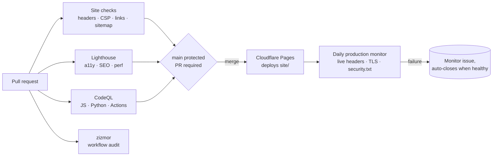

# Site operations: CI, monitoring and security controls

How changes to nexussecurityadvisors.com are checked, deployed and watched.



## Workflows

| Workflow | Runs | Checks |
|---|---|---|
| [Site checks](../.github/workflows/site-checks.yml) | push, PR | `tools/check_site.py`: required security headers, strict `script-src`, `frame-ancestors 'none'`, HSTS ≥ 180 days, no executable inline scripts, every internal link and asset resolves, sitemap ↔ pages, `security.txt` fields and expiry ([RFC 9116](https://www.rfc-editor.org/rfc/rfc9116)). Then [Lighthouse CI](https://github.com/GoogleChrome/lighthouse-ci) on key pages (accessibility and SEO ≥ 90 must pass). |
| [Production monitor](../.github/workflows/monitor.yml) | daily | Same header checks against the live site, CSP drift vs. `site/_headers`, TLS certificate ≥ 21 days, live `security.txt` expiry. Opens one issue on failure and closes it when healthy. |
| [CodeQL](../.github/workflows/codeql.yml) | push, PR, weekly | JavaScript, Python (`tools/`) and workflow analysis |
| [Workflow security](../.github/workflows/workflow-security.yml) | `.github/` changes, weekly | [zizmor](https://docs.zizmor.sh/) audit, results in code scanning |
| [Dependabot](../.github/dependabot.yml) | weekly | Updates for SHA-pinned Actions |

All workflows start from `permissions: {}`, grant each job only what it needs, pin actions to commit SHAs and never persist the checkout token.

## Repository security settings

- `main` is protected by a ruleset: changes arrive by pull request, force-push and deletion are blocked.
- Secret scanning with push protection, Dependabot alerts and security updates, malware alerts, and private vulnerability reporting are enabled.

## Run the checks locally

```bash
python3 tools/check_site.py           # repository checks
python3 tools/check_site.py --live    # plus the production site
npx -y @lhci/cli@0.15.1 autorun       # Lighthouse (needs Chrome)
```

## Routine reminders

- **security.txt** must be re-dated before `Expires` (currently 2027-10-01); CI fails 30 days before and warns at 90.
- **HSTS** is 180 days to match the zone policy. Raise to ≥ 1 year with `includeSubDomains; preload` only when every subdomain is HTTPS-only.
- **Cloudflare Web Analytics** is blocked by the CSP. Either disable it for the Pages project (PostHog already covers analytics) or allow `https://static.cloudflareinsights.com` in `script-src` and `https://cloudflareinsights.com` in `connect-src`.

References: [OWASP Secure Headers Project](https://owasp.org/www-project-secure-headers/) · [MDN: Content-Security-Policy](https://developer.mozilla.org/en-US/docs/Web/HTTP/Headers/Content-Security-Policy) · [RFC 9116: security.txt](https://www.rfc-editor.org/rfc/rfc9116) · [Cloudflare Pages headers](https://developers.cloudflare.com/pages/configuration/headers/)
